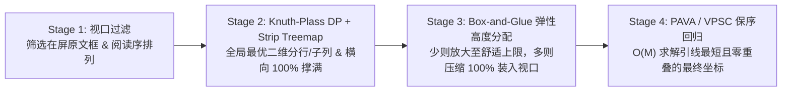

# 侧边栏动态视口贪心排版规范（SPEC）

本文档定义 `EndTranslate` 右侧译文侧边栏的**视口内动态激活**与**二维贪心自适应排版算法**规范，供后续实现、代码审查与回归测试直接参照执行。

---

## 1. 背景与核心目标

### 1.1 现状痛点
1. **离屏标注挤占可视空间**：现有 [`SelectionOverlay.layoutSidebarCards()`](Sources/EndTranslate/PDF/SelectionOverlay.swift) 将整篇文档的所有标注一并参与排版，已滑出窗口的译文卡片仍占据纵向坐标，甚至将当前屏幕内原文对应的译文挤出可视区域。
2. **空间利用率失衡**：
   - 当屏幕内仅有少量译文时，卡片维持固定小尺寸，侧边栏留下大面积空白；
   - 当屏幕内有大量短标签（如架构图、流程图节点）与长段落并存时，同行右侧留白未被充分利用，且纵向总高度超出窗口高度导致卡片溢出屏幕外；
3. **缩放与裁剪问题**：[`RenderedTranslation.draw`](Sources/EndTranslate/Render/RenderedTranslation.swift) 仅按 `rect.width / box.width` 单轴缩放，若卡片高度被压缩或扩展，会导致内容底部被裁切或产生不协调留白。

### 1.2 核心设计目标
1. **视口内动态激活（Viewport-Only Activation）**：只有原文高亮框处于当前窗口可视区域内时，对应译文才进入侧边栏展示队列；原文滑出窗口后译文立即隐藏，释放侧边栏空间。
2. **横向 100% 贪心撑满（Horizontal Greedy Justification）**：每一行（含单卡片行、多列并排行、子列堆叠行）均按内容权重瓜分并撑满侧边栏的整行可用宽度，消除右侧残余空洞。
3. **纵向双向自适应（Bi-directional Vertical Adaptation）**：
   - **少则舒展（Comfort Expansion）**：当窗口内译文较少时，在舒适阅读字号上限（如基准的 $1.0\times \sim 1.45\times$，约 `11pt ~ 16pt`）内放大字号与卡片内留白，并结合弹性间距向原文锚点靠拢；
   - **多则必装入（Guaranteed Viewport Fit）**：当窗口内译文密集时，自动优先采用多列并排降低行数，并按需等比缩小行高与字号，**确保所有在屏原文的译文 100% 装入当前窗口侧边栏高度内，绝不溢出屏幕上下边界**。
4. **阅读舒适与引线保序（Reading Comfort & Topology Preservation）**：保持自然阅读顺序（从上到下、同行从左到右），最小化三次贝塞尔引线的纵向偏移，确保连线平滑、不乱序交叉。屏幕上的静止引线按可见配对数分层淡化或隐藏；鼠标悬停原文框或卡片时才显示当前配对的一条强调引线。导出 PDF 不具备悬停状态，仍绘制全部连线。
5. **实时性能（60/120fps Real-Time Budget）**：单帧排版算法纯 CPU 几何求解耗时 $< 0.1\text{ms}$，滚动与缩放完全丝滑。

---

## 2. 算法理论基础与参考模型

本方案将问题拆解为四个正交阶段，直接组合三套成熟的计算几何与排版算法：

| 阶段 | 解决的问题 | 经典参考算法 | 时间复杂度 |
| :--- | :--- | :--- | :--- |
| **Stage 1：视口过滤与拓扑排序** | 筛选在屏原文框并建立稳定阅读序 | 视口交集阈值判定 + 二维行带偏序 | $O(N \log N)$ |
| **Stage 2：二维分行与横向撑满** | 决定哪些卡片同行并排/子列堆叠，并撑满每行宽度 $W$ | **Strip Treemap** (Bederson et al., 2002) + **Knuth-Plass 动态规划折行** (1981) / Justified Layout | $O(N^2)$（$N \le 30$ 时 $< 0.05\text{ms}$） |
| **Stage 3：纵向空间弹性分配** | 译文少时在舒适上限内放大，译文多时按权重压缩进一屏高度 $H$ | **TeX Box-and-Glue 垂直弹性盒模型** / **CSS Flexbox** (`flex-grow` / `flex-shrink`) | $O(M)$（$M$ 为行数） |
| **Stage 4：纵向锚点最优对齐** | 在不重叠、不出界前提下，使所有卡片离原文 $Y$ 坐标最近 | **Boundary Labeling** (Bekos et al.) + **VPSC / PAVA 保序回归** (Dwyer et al., 2005) | $O(M)$ |

---

## 3. 四阶段实时算法详细规范

### 3.1 Stage 1：视口内可见性判定与阅读序排序

#### 3.1.1 坐标定义
在 [`SelectionOverlay`](Sources/EndTranslate/PDF/SelectionOverlay.swift)（`isFlipped == true`，原点在左上角，$Y$ 轴向下）中：
- 左侧 PDF 可视面板区域为 `pdfPanelRect`（宽 $W_{\text{pdf}}$，高 $H_{\text{view}} = \text{bounds.height}$）；
- 右侧侧边栏可视区域为 `sidebarRect`；
- 侧边栏卡片可用水平起点 $X_0 = \text{sidebarRect.minX} + \text{cardHorizontalInset}$，可用总宽 $W = \text{sidebarRect.width} - 2 \times \text{cardHorizontalInset}$；
- 侧边栏卡片可用垂直区间 $[Y_{\min}, Y_{\max}] = [\text{pageVerticalInset}, H_{\text{view}} - \text{pageVerticalInset}]$，可用总高 $H = Y_{\max} - Y_{\min}$。

#### 3.1.2 窗口内可见性判定函数 `isSourceVisibleInViewport`
对于任意标注 $i$，将其 PDF 页面坐标选区 `model.rect` 转换到 overlay 坐标得到 `sourceRect`。当且仅当同时满足以下水平与垂直条件时，该标注进入当前帧的活跃集合 $S$：

1. **水平交集**：
   $$\text{sourceRect.maxX} > \text{pdfPanelRect.minX} + 2 \quad \land \quad \text{sourceRect.minX} < \text{pdfPanelRect.maxX} - 2$$
2. **垂直可见性（满足以下任一条件即可，防止边缘闪烁）**：
   设垂直交集区间为 $[y_{\text{top}}, y_{\text{bot}}] = [\max(\text{sourceRect.minY}, \text{pdfPanelRect.minY}), \min(\text{sourceRect.maxY}, \text{pdfPanelRect.maxY})]$，交集高度 $h_{\text{vis}} = \max(0, y_{\text{bot}} - y_{\text{top}})$：
   - **露出比例达标**：$h_{\text{vis}} / \max(\text{sourceRect.height}, 1) \ge 0.25$（至少露出 $25\%$ 高度）；
   - **中心点在屏**：$\text{sourceRect.midY} \in [\text{pdfPanelRect.minY}, \text{pdfPanelRect.maxY}]$；
   - **超大选区露出达标**：$h_{\text{vis}} \ge 0.20 \times H_{\text{view}}$。

> **离屏清理**：所有未通过 `isSourceVisibleInViewport` 判定的标注，必须在当帧将其 `view.bounds = .zero`，不绘制卡片与连线，也不响应侧边栏鼠标命中。

#### 3.1.3 自然阅读序排序
对活跃集合 $S$ 中的标注，按以下优先级排序得到序列 $1, 2, \dots, N$：
1. 页码 `page` 升序；
2. 同一行判定：若两个原文框的垂直中心或顶部距离 $|\text{minY}_a - \text{minY}_b| \le \max(6, 0.35 \times \min(h_a, h_b))$，视为同一水平行带，按 `sourceRect.minX` 升序（从左到右）；
3. 否则按 `sourceRect.minY` 升序（屏幕从上到下）；
4. `id.uuidString` 字典序兜底，保证确定性。

---

### 3.2 Stage 2：Knuth-Plass 动态规划分行与横向贪心撑满

#### 3.2.1 卡片基础度量属性
每个活跃卡片 $i \in \{1 \dots N\}$ 具有：
- **理想锚点纵坐标**：$d_i = \text{clamp}(\text{sourceRect}_i.\text{midY}, Y_{\min}, Y_{\max})$（或顶部坐标 $\text{sourceRect}_i.\text{minY}$）；
- **基准尺寸 $(w_i^{\text{nat}}, h_i^{\text{nat}})$**：卡片在基准字号（`10~11pt`）下通过 `TranslationAnnotation.cardSize(maxCardWidth: W)` 测得的紧致外框宽高；
- **面积/内容量权重**：$A_i = w_i^{\text{nat}} \times h_i^{\text{nat}}$；
- **是否独占整行（Full-Width Block）**：若包含块级公式（`$$`、`\[`）、Markdown 表格，或单段字数单位 `totalUnits > 42`，标记 `isFullWidth = true`（但当视口极度拥挤时可放宽至最多 2 列）。

#### 3.2.2 行内横向 100% 撑满与高度估算（Row Formation）
当连续子序列 $R = [i \dots j]$（$1 \le i \le j \le N$，最多包含 $K_{\max} = 4$ 个卡片）被组合成同一行（Strip）时：

##### 情形 A：纯并排列（Side-by-Side Columns）
设行内有 $k = j - i + 1$ 列，水平列间距为 $g_x = \text{cardHorizontalSpacing} = 6\text{pt}$，行内可用净宽为：
$$W_{\text{net}} = W - (k - 1) g_x$$
- **可行性剪枝**：若 $k > 1$ 且 $\sum_{t=i}^j \min(w_t^{\text{nat}}, w_{\min}) > W_{\text{net}}$，或某卡片缩小后宽度低于硬下限 `minCardWidth = 42pt`，则该合并方案不可行（当屏幕不拥挤时直接剪枝）。
- **横向按权重 100% 瓜分（Greedy Horizontal Fill）**：
  每个卡片以 $w_t^{\text{weight}} = (w_t^{\text{nat}})^{0.85}$（指数 $0.85$ 防止长短差异悬殊时短卡片被挤扁）作为权重，分配行内宽度：
  $$w_t = W_{\text{net}} \cdot \frac{w_t^{\text{weight}}}{\sum_{u=i}^j w_u^{\text{weight}}}, \quad x_t = X_0 + \sum_{u=i}^{t-1} (w_u + g_x)$$
  由此保证**每一行从左边界 $X_0$ 到右边界 $X_0 + W$ 严格 100% 填满，无右侧残余空洞**。
- **行基准高度 $h_R^{\text{base}}$**：
  对行内每个卡片 $t$，当分配宽度变为 $w_t$ 时：
  - 若是纯文本/自适应重排卡片，其高度近似为 $h_t(w_t) \approx h_t^{\text{nat}} \cdot \text{clamp}(w_t^{\text{nat}} / w_t, 0.75, 1.35)$；
  - 若是固定长宽比矢量块（如单行短标签或公式），其等比缩放比例为 $s_t = w_t / w_t^{\text{nat}}$，对应等比高度为 $h_t^{\text{nat}} \cdot \min(s_t, \alpha_{\max})$；
  - 该行的统一基准高度取各列最大值：$h_R^{\text{base}} = \max_{t \in [i..j]} h_t(w_t)$，且**同行内所有并排卡片的外框高度统一对齐为该行最终高度**（形成整齐的 Bento 网格行）。

##### 情形 B：高卡片旁的子列堆叠（Sub-column Stacking）
若子序列 $[i \dots j]$（如 $3$ 个卡片）中左侧卡片 $i$ 较高（如多行图注或段落），而右侧连续卡片 $i+1 \dots j$ 为短标签：
- 左侧列 1 包含卡片 $i$，右侧列 2 包含纵向堆叠的卡片 $i+1 \dots j$（中间留垂直间距 $g_y = 6\text{pt}$）；
- 列 1 与列 2 的宽度按 $(w_i^{\text{nat}}, \max_{t > i} w_t^{\text{nat}})$ 权重瓜分 $W - g_x$；
- 右侧子列内各卡片按各自 $h_t^{\text{nat}}$ 比例瓜分该行的总高度 $h_R$，同样做到**横向与纵向严丝合缝对齐**。

#### 3.2.3 Knuth-Plass 动态规划求解全局最优分行
为了同时适应“稀疏视口”和“密集视口”，首先计算全部单卡片独占一行时的总高度 $H_{\text{single}} = \sum_{i=1}^N h_i^{\text{nat}} + (N-1)g_y$，定义**视口拥挤度（Crowding Ratio）**：
$$\rho = \frac{H_{\text{single}}}{H}$$

定义单行 $[i \dots j]$ 的综合不舒适代价 `rowCost(i..j)`：
$$C(i \dots j) = C_{\text{scale}}(i \dots j) + C_{\text{span}}(i \dots j) + C_{\text{waste}}(i \dots j) + C_{\text{height}}(i \dots j)$$
其中：
1. **宽度挤压/拉伸代价 $C_{\text{scale}}$**：
   - 若并排后某卡片宽度 $w_t < w_t^{\text{nat}}$，产生挤压惩罚 $80 \times (1 - w_t / w_t^{\text{nat}})^2$；
   - 若某短卡片在单列中被过度拉宽（$w_t > 2.2 \times w_t^{\text{nat}}$），产生空旷惩罚 $18 \times (w_t / w_t^{\text{nat}} - 2.2)$，鼓励短卡片相互并排；
2. **同行原文纵向跨度代价 $C_{\text{span}}$**：
   - 设同行内原文锚点的纵向跨度 $\Delta d = \max_{t \in [i..j]} d_t - \min_{t \in [i..j]} d_t$；
   - 允许同行合并的特征跨度阈值随拥挤度 $\rho$ 动态自适应：
     $$\Delta d_{\text{allow}} = 28 + 90 \times \text{clamp}(\rho - 0.7, 0, 1.5)$$
   - 当 $\Delta d \le \Delta d_{\text{allow}}$ 时惩罚很小（$0.25 \times \Delta d$）；超出后施加二次惩罚 $1.5 \times (\Delta d - \Delta d_{\text{allow}})^2 / \Delta d_{\text{allow}}$，防止在不拥挤时把上下相距很远的两个框硬拼在一行。
3. **行高占用代价 $C_{\text{height}}$**：
   - 权重随拥挤度 $\rho$ 增大：$\lambda_h(\rho) = 1.2 \times \max(0, \rho - 0.85)^2 \times (h_R^{\text{base}} + g_y)$。当 $\rho > 1$（单列放不下）时，算法自动通过并排降低总高。

**状态转移方程**：
$$DP[0] = 0, \quad DP[j] = \min_{1 \le j - i + 1 \le 4} \bigl( DP[i - 1] + C(i \dots j) \bigr) \quad (1 \le j \le N)$$
通过回溯 `parent[j]` 即可在 $O(N)$ 步内还原出最优行序列 $\mathcal{R} = (R_1, R_2, \dots, R_M)$。

---

### 3.3 Stage 3：TeX Box-and-Glue 纵向空间分配

给定 Stage 2 生成的 $M$ 个行 $R_1 \dots R_M$，其基准高度为 $h_1^{\text{base}}, \dots, h_M^{\text{base}}$，行间距为 $g_y = 6\text{pt}$。
记总间距 $G = (M - 1) g_y$，可用净高 $H_{\text{net}} = \max(H - G, M \times 18)$，基准净高总和 $H_{\text{base}} = \sum_{r=1}^M h_r^{\text{base}}$。

#### 3.3.1 情形 1：密集视口压缩（$H_{\text{base}} > H_{\text{net}}$，Guaranteed Fit）
当所有行的自然高度之和超出当前侧边栏净高 $H_{\text{net}}$ 时：
- 若行间距仍可微调，先将 $g_y$ 从 $6\text{pt}$ 线性收紧至最小 $4\text{pt}$，重算 $H_{\text{net}}$；
- 计算全局纵向压缩率：
  $$\alpha = \frac{H_{\text{net}}}{H_{\text{base}}} < 1.0$$
- 每一行的最终分配高度严格按权重压缩：
  $$h_r = h_r^{\text{base}} \cdot \alpha$$
- 此时 $\sum_{r=1}^M h_r + (M-1)g_y \equiv H$，**100% 保证所有在屏译文严丝合缝装入当前窗口侧边栏高度内，绝不溢出屏幕上下边界**。

#### 3.3.2 情形 2：充裕视口舒展（$H_{\text{base}} \le H_{\text{net}}$，Comfort Expansion）
当侧边栏纵向有富余空间时：
- 定义单行**最大舒适放大倍率** $\alpha_{\max} = 1.45$（对应正文字号从 `11pt` 放大至约 `16pt` 上限，外加上下舒适内边距，避免只有一两个词时变成巨型大字报）；
- 计算全局目标放大倍率：
  $$\alpha = \min\!\left(\frac{H_{\text{net}}}{H_{\text{base}}},\; \alpha_{\max}\right) \in [1.0, 1.45]$$
- 每一行分配舒展后的高度：
  $$h_r = h_r^{\text{base}} \cdot \alpha + \delta_{\text{pad}}$$
  其中 $\delta_{\text{pad}} = \min\!\bigl(10,\; \max(0, (H_{\text{net}} - \alpha H_{\text{base}}) / M \times 0.35)\bigr)$ 为适度增加的卡片上下呼吸留白。

---

### 3.4 Stage 4：Boundary Labeling + PAVA 保序回归纵向定位

经过 Stage 3 后，每行的最终高度 $h_r$ 已确定，且必然满足 $\sum_{r=1}^M h_r + (M - 1) g_y \le H$。
- 若 $\sum_{r=1}^M h_r + (M - 1) g_y == H$（已完全填满侧边栏高度），各行直接从 $Y_{\min}$ 到 $Y_{\max}$ 紧密排列：
  $$y_1 = Y_{\min}, \quad y_r = y_{r-1} + h_{r-1} + g_y$$
- 若放大到舒适上限 $\alpha_{\max}$ 后仍有剩余纵向空间（$\sum h_r + (M - 1) g_y < H$），则求解如下**带边界与分离约束的一维保序回归（Isotonic Regression / VPSC）问题**，使每行尽可能对齐其原文框在窗口中的纵坐标，同时适度向视口展开：

#### 3.4.1 目标位置与转化
对于第 $r$ 行：
- 原文锚点中心均值 $d_r^{\text{src}} = \frac{1}{|R_r|} \sum_{t \in R_r} \text{sourceRect}_t.\text{midY}$；
- 视口均匀分布中心 $d_r^{\text{even}}$（将 $[Y_{\min}, Y_{\max}]$ 按行高比例均匀铺开的中心点）；
- **混合目标顶部坐标 $d_r$**：兼顾“原文引线对齐（权重 $0.75$）”与“视口空间舒展（权重 $0.25$）”：
  $$d_r = 0.75 \times \bigl(d_r^{\text{src}} - 0.5 h_r\bigr) + 0.25 \times \bigl(d_r^{\text{even}} - 0.5 h_r\bigr)$$

定义前缀累积高度偏移 $O_1 = 0, \; O_r = \sum_{k=1}^{r-1} (h_k + g_y)$，令变换变量 $z_r = y_r - O_r$，分离约束 $y_r + h_r + g_y \le y_{r+1}$ 等价于**标准单调不减约束**：
$$Y_{\min} \le z_1 \le z_2 \le \dots \le z_M \le Y_{\max} - (O_M + h_M)$$
目标函数为最小化加权平方偏差：
$$\min_{z_1 \dots z_M} \sum_{r=1}^M w_r \bigl(z_r - (d_r - O_r)\bigr)^2$$

#### 3.4.2 $O(M)$ PAVA（Pool Adjacent Violators Algorithm）求解流程
1. 初始化单调块栈 `blocks = []`；
2. 对 $r = 1 \dots M$：
   - 创建新块 $B = \{\text{indices}: [r], \; \text{weight}: w_r, \; \text{value}: d_r - O_r\}$；
   - **当栈顶块 `top` 违反单调性（`top.value > B.value`）时**：弹出 `top` 并与 $B$ 合并，新块权重为 $w_{\text{top}} + w_B$，新块值为加权均值：
     $$B.\text{value} = \frac{w_{\text{top}} \cdot \text{top.value} + w_B \cdot B.\text{value}}{w_{\text{top}} + w_B}$$
   - 将 $B$ 压入栈；
3. 对栈中每个块，将其 `value` 钳制（clamp）在合法边界 $[Y_{\min}, Y_{\max} - (O_M + h_M)]$ 内；
4. 还原每行最终顶部纵坐标：$y_r = z_r + O_r$。

> **性质保证**：PAVA 算法在 $O(M)$ 时间内给出严格全局最优解，任意两行绝不重叠、绝不越出 $[Y_{\min}, Y_{\max}]$ 窗口边界，且贝塞尔引线保持严格单调不交叉。

---

## 4. 卡片内等比保真绘制规范（In-Card Rendering）

由于算法会动态放大或缩小卡片外框 `cardRect`（以及其中的内容区 `contentRect`），卡片内部绘制必须遵循**等比保真缩放（Aspect-Ratio Preserving Scaling）**，严禁单轴拉伸或纵向裁切：

### 4.1 矢量 PDF 绘制（[`RenderedTranslation.draw`](Sources/EndTranslate/Render/RenderedTranslation.swift)）
现有实现仅计算了 `let scale = rect.width / box.width`，导致当 `rect` 更宽或更矮时底部内容被 `ctx.clip(to: rect)` 截断。应修改为：
1. 计算水平与垂直双轴可用缩放比，并限制在最大舒适倍率 $\alpha_{\max} = 1.45$ 以内：
   $$\text{scale} = \min\!\left(\frac{\text{rect.width}}{\text{box.width}},\; \frac{\text{rect.height}}{\text{box.height}},\; 1.45\right)$$
2. 计算绘制实际尺寸：
   $$W_{\text{draw}} = \text{box.width} \times \text{scale}, \quad H_{\text{draw}} = \text{box.height} \times \text{scale}$$
3. **对齐方式**：
   - **垂直方向居中对齐**：$y_{\text{offset}} = (\text{rect.height} - H_{\text{draw}}) \times 0.5$，使卡片在纵向舒展时上下自然留白；
   - **水平方向**：若为单行短标签（`box.width < rect.width * 0.75` 且 `box.height < 28`）可水平居中或左对齐留出舒适边距；长段落保持左对齐（$x_{\text{offset}} = 0$）。

### 4.2 CoreText 回退文本绘制（[`TranslationAnnotation.drawText`](Sources/EndTranslate/Annotations/TranslationAnnotation.swift)）
1. 字号搜索上限从固定 `10pt` 提升至动态区间 `[5.5pt, 15.5pt]`；
2. 二分或递减寻找能在 `logicalRect` 宽度与高度内完整排下的最大字号 $f \in [5.5, 15.5]$；
3. 计算实际排版高度 `fitHeight` 后，在 `rect` 内垂直居中绘制（偏移 `(rect.height - fitHeight * scale) * 0.5`）。

### 4.3 异步重排策略（WebKit Re-typesetting）
- **滚动与缩放期间（60fps 实时路径）**：直接利用已有 `RenderedTranslation` 矢量 PDF 与上述等比缩放绘制，零异步等待、零卡顿；
- **侧边栏宽度拖拽调整后（Debounced Path）**：维持 `180ms` 防抖，按新侧边栏宽度重新调用 `MarkdownRenderer` 排版。

---

## 5. PDF 导出行为规范（[`PDFExporter`](Sources/EndTranslate/Export/PDFExporter.swift)）

根据已确认的需求（A4）：
- 导出 PDF 的每一页本身就是一个完整的静态窗口视口，该页所有已完成标注天然处于视口内；
- [`CardSidebarLayout.placeExportCards`](Sources/EndTranslate/PDF/PageGaps.swift) 直接将单页高度 `[pageBounds.minY + inset, pageBounds.maxY - inset]` 作为视口容器 $[Y_{\min}, Y_{\max}]$，调用同一套 **Stage 2 (Knuth-Plass DP) + Stage 3 (Box-and-Glue) + Stage 4 (PAVA)** 求解器；
- 由于 Stage 3 保证所有卡片 100% 装入单页高度内，导出的 PDF 页面高度 `exportBox.height` 始终等于原始 `pageBox.height`，不再需要向下无限拉长页面底边。

---

## 6. 代码改造文件清单

| 文件路径 | 改造内容摘要 |
| :--- | :--- |
| [`Sources/EndTranslate/PDF/SelectionOverlay.swift`](Sources/EndTranslate/PDF/SelectionOverlay.swift) | 在 `layoutSidebarCards()` 中增加 `isSourceVisibleInViewport(sourceRect, in: pdfPanelRect)` 过滤；离屏标注清空 `bounds = .zero`；将当前窗口可视区间 `[0, sidebarRect.height]` 传入 `CardSidebarLayout.placeScreenCards`。 |
| [`Sources/EndTranslate/PDF/PageGaps.swift`](Sources/EndTranslate/PDF/PageGaps.swift) | 重构 `CardSidebarLayout`：实现 Stage 2（Knuth-Plass DP 二维分行 + 横向按权重 100% 撑满 + 子列堆叠）、Stage 3（Box-and-Glue 纵向舒适放大与保底压缩）及 Stage 4（PAVA 保序回归对齐）。 |
| [`Sources/EndTranslate/Render/RenderedTranslation.swift`](Sources/EndTranslate/Render/RenderedTranslation.swift) | 更新 `draw(in:context:yDown:)`：采用 `min(widthScale, heightScale, 1.45)` 等比缩放并在卡片内容区内垂直居中绘制，杜绝高度压缩时的底部截断。 |
| [`Sources/EndTranslate/Annotations/TranslationAnnotation.swift`](Sources/EndTranslate/Annotations/TranslationAnnotation.swift) | 更新 `drawText` 支持在 `[5.5, 15.5]` 字号区间内自适应放大/缩小并垂直居中；提供卡片自然宽高与内容量权重计算接口。 |
| [`Sources/EndTranslate/Export/PDFExporter.swift`](Sources/EndTranslate/Export/PDFExporter.swift) | 导出单页时复用视口贪心填满算法，确保每页侧边栏饱满排列且不超出单页底边。 |
| [`Tests/EndTranslateTests/PDFNavigationTests.swift`](Tests/EndTranslateTests/PDFNavigationTests.swift) | 新增与更新单元测试：验证离屏过滤、同行宽度 100% 撑满、少量卡片舒适放大、密集卡片（15+ 个）100% 装入视口高度零溢出、PAVA 零重叠且保序。 |

---

## 7. 验收标准（Acceptance Criteria）

1. **视口联动测试**：上下滚动 PDF 时，只有进入窗口可视区域的原文框才在右侧显示译文卡片；滑出窗口的原文框对应译文立即消失，在屏译文平滑重新分配空间。
2. **横向零空洞测试**：任意一行（无论是单卡片、双列、三列还是子列堆叠）的左边界均对齐 `cardX`，最右侧卡片的右边界均对齐 `cardX + cardWidth`（误差 $< 0.5\text{pt}$）。
3. **密集不溢出测试**：当单屏内同时存在 12～20 个译文框时，所有卡片均无重叠（`frame_i.intersects(frame_j) == false`），且所有卡片严格满足 `minY >= pageVerticalInset` 且 `maxY <= viewportHeight - pageVerticalInset`。
4. **稀疏舒适度测试**：当单屏内仅有 1～3 个短译文框时，卡片横向撑满、字号与留白在 $1.45\times$ 舒适上限内放大，且纵向位置贴近原文锚点，不产生文字变形或裁切。
5. **全量自动化测试通过**：`zsh scripts/test.sh` 全部通过。
